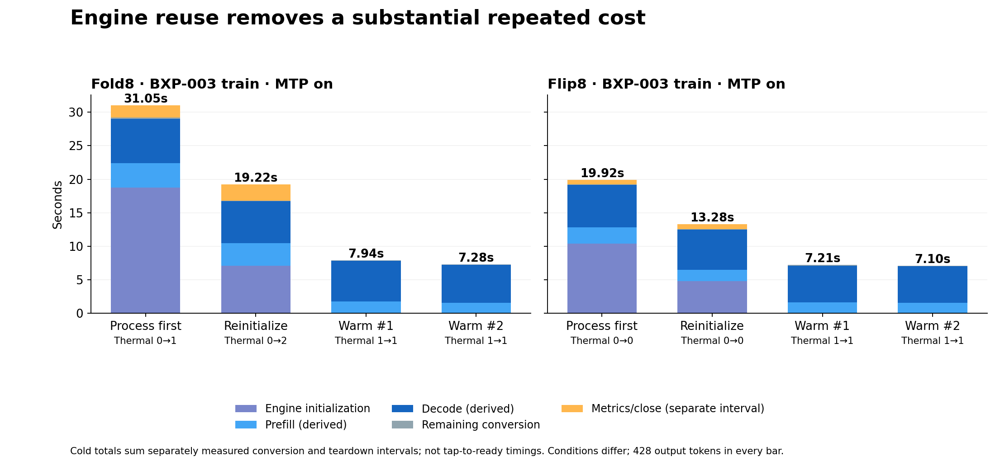
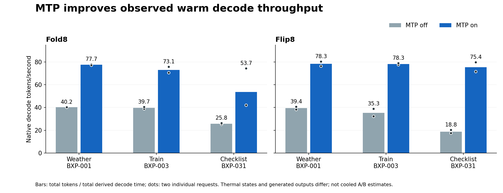

# Inference bottleneck profile

**Completed run plan** · 2026-10-11T03:56:08+00:00 · 8 discovered arms, 8 complete, 36 saved measured requests and 6 excluded startup warmups.

The comparison uses the trained E2B converter, corrected FP16 model, frozen Bixby50 inputs and native LiteRT metrics. Arm medians and weighted rates below include **all observed requests with available values**; strict-cooled counts are shown separately. All time values below are milliseconds unless marked seconds or tokens/s. Device results remain separate.

## Arm summary

| Device | Order | Arm | State | Strict-cooled/observed | All-run convert median s | All-run provider median s | All-run init median s | All-run prefill median s* | All-run decode median s* | All-run native decode tok/s† | Strict-cooled convert median s | Raw accepted/final saved | Thermal / engine flags |
|---|---:|---|---|---:|---:|---:|---:|---:|---:|---:|---:|---|
| SM-F971B | 1 | `baseline_cold_mtp_on` | complete | 0/2 | 23.01 | 22.94 | 12.93 | 3.50 | 6.43 | 66.5 | — | 2/2 | timeouts 0; engine mismatches 0 |
| SM-F971B | 2 | `controls_warm_mtp_on` | complete | 0/6 | 7.61 | 7.54 | 0.00 | 1.67 | 5.86 | 60.9 | — | 6/6 | timeouts 6; engine mismatches 0 |
| SM-F971B | 3 | `controls_warm_mtp_off` | complete | 0/6 | 12.29 | 12.21 | 0.00 | 1.71 | 10.43 | 30.1 | — | 6/6 | timeouts 6; engine mismatches 0 |
| SM-F971B | 4 | `controls_stream_mtp_on` | complete | 0/4 | 6.27 | 6.20 | 0.00 | 1.64 | 4.43 | 73.4 | — | 4/4 | timeouts 4; engine mismatches 0 |
| SM-F776U | 1 | `baseline_cold_mtp_on` | complete | 2/2 | 15.92 | 15.86 | 7.62 | 2.02 | 6.19 | 69.1 | 15.92 | 2/2 | timeouts 0; engine mismatches 0 |
| SM-F776U | 2 | `controls_warm_mtp_off` | complete | 1/6 | 13.70 | 13.64 | 0.00 | 1.72 | 11.74 | 23.4 | 6.79 | 6/6 | timeouts 4; engine mismatches 0 |
| SM-F776U | 3 | `controls_warm_mtp_on` | complete | 0/6 | 7.16 | 7.10 | 0.00 | 1.72 | 5.47 | 76.6 | — | 6/6 | timeouts 6; engine mismatches 0 |
| SM-F776U | 4 | `controls_stream_mtp_on` | complete | 0/4 | 6.20 | 6.15 | 0.00 | 1.62 | 4.09 | 78.2 | — | 4/4 | timeouts 4; engine mismatches 0 |

* Prefill and decode durations are derived from native token counts and native rates; they are estimates. † Native decode throughput is token weighted, not an average of per-request rates.

## Excluded startup warmups

These are real cold engine starts before warm reused requests. They are excluded from arm medians and all off/on pairs. No per-case cooldown was required before a warmup, so prior arm heat can affect it; thermal status is shown where available.

| Device | Arm | Thermal start→end | Runtime | Engine initialized | Conversion s | Init s | Prefill s* | Decode s* | Output tokens | Native decode tok/s |
|---|---|---|---|---|---:|---:|---:|---:|---:|---:|
| SM-F971B | `controls_warm_mtp_on` | 1→1 | LiteRT-LM/Gemma4/GPU+FP16_CORRECTED+MTP | yes | 23.55 | 16.84 | 3.07 | 3.48 | 214 | 61.6 |
| SM-F971B | `controls_warm_mtp_off` | 4→4 | LiteRT-LM/Gemma4/GPU+FP16_CORRECTED | yes | 53.12 | 34.99 | 4.28 | 13.50 | 214 | 15.9 |
| SM-F971B | `controls_stream_mtp_on` | 4→3 | LiteRT-LM/Gemma4/GPU+FP16_CORRECTED+MTP | yes | 45.19 | 35.08 | 2.83 | 7.06 | 214 | 30.3 |
| SM-F776U | `controls_warm_mtp_off` | 0→0 | LiteRT-LM/Gemma4/GPU+FP16_CORRECTED | yes | 22.26 | 14.36 | 1.49 | 6.31 | 214 | 33.9 |
| SM-F776U | `controls_warm_mtp_on` | 2→2 | LiteRT-LM/Gemma4/GPU+FP16_CORRECTED+MTP | yes | 25.93 | 20.83 | 1.52 | 3.47 | 214 | 61.6 |
| SM-F776U | `controls_stream_mtp_on` | 1→2 | LiteRT-LM/Gemma4/GPU+FP16_CORRECTED+MTP | yes | 15.25 | 10.16 | 1.50 | 3.52 | 214 | 60.7 |

## Request phases

| Device | Arm | Case | Engine | Thermal start→end | Init s | Prefill s* | Decode s* | Provider residual s* | SDK outside provider s | Convert s | First partial s | First ready preview s | Output tokens | Flags |
|---|---|---|---|---|---:|---:|---:|---:|---:|---:|---:|---:|---:|---|
| SM-F971B | `baseline_cold_mtp_on` | BXP-003 #1 | cold | 0→1 | 18.78 | 3.63 | 6.60 | 0.12 | 0.07 | 29.20 | 23.15 | 24.20 | 428 | thermal-end-nonzero |
| SM-F971B | `baseline_cold_mtp_on` | BXP-003 #2 | cold | 0→2 | 7.09 | 3.38 | 6.27 | 0.03 | 0.07 | 16.82 | 11.04 | 11.92 | 428 | thermal-end-nonzero |
| SM-F971B | `controls_warm_mtp_on` | BXP-001 #1 | warm | 1→1 | 0.00 | 1.39 | 2.74 | 0.02 | 0.06 | 4.20 | 1.53 | — | 214 | cooldown-timeout, thermal-gate-unverified, thermal-start-nonzero, thermal-end-nonzero |
| SM-F971B | `controls_warm_mtp_on` | BXP-003 #1 | warm | 1→1 | 0.00 | 1.77 | 6.06 | 0.02 | 0.08 | 7.94 | 2.03 | — | 428 | cooldown-timeout, thermal-gate-unverified, thermal-start-nonzero, thermal-end-nonzero |
| SM-F971B | `controls_warm_mtp_on` | BXP-031 #1 | warm | 1→2 | 0.00 | 2.10 | 11.92 | 0.03 | 0.16 | 14.21 | 2.23 | — | 886 | cooldown-timeout, thermal-gate-unverified, thermal-start-nonzero, thermal-end-nonzero |
| SM-F971B | `controls_warm_mtp_on` | BXP-001 #2 | warm | 2→2 | 0.00 | 1.43 | 2.77 | 0.02 | 0.04 | 4.25 | 1.56 | — | 214 | cooldown-timeout, thermal-gate-unverified, thermal-start-nonzero, thermal-end-nonzero |
| SM-F971B | `controls_warm_mtp_on` | BXP-003 #2 | warm | 1→1 | 0.00 | 1.56 | 5.65 | 0.02 | 0.05 | 7.28 | 1.68 | — | 428 | cooldown-timeout, thermal-gate-unverified, thermal-start-nonzero, thermal-end-nonzero |
| SM-F971B | `controls_warm_mtp_on` | BXP-031 #2 | warm | 2→4 | 0.00 | 4.31 | 21.05 | 0.12 | 0.20 | 25.67 | 4.89 | — | 886 | cooldown-timeout, thermal-gate-unverified, thermal-start-nonzero, thermal-end-nonzero |
| SM-F971B | `controls_warm_mtp_off` | BXP-001 #1 | warm | 2→2 | 0.00 | 1.39 | 5.32 | 0.02 | 0.04 | 6.78 | 1.49 | — | 214 | cooldown-timeout, thermal-gate-unverified, thermal-start-nonzero, thermal-end-nonzero |
| SM-F971B | `controls_warm_mtp_off` | BXP-003 #1 | warm | 2→3 | 0.00 | 1.91 | 10.64 | 0.02 | 0.09 | 12.66 | 2.04 | — | 414 | cooldown-timeout, thermal-gate-unverified, thermal-start-nonzero, thermal-end-nonzero |
| SM-F971B | `controls_warm_mtp_off` | BXP-031 #1 | warm | 2→4 | 0.00 | 2.29 | 36.60 | 0.04 | 0.21 | 39.14 | 2.44 | — | 926 | cooldown-timeout, thermal-gate-unverified, thermal-start-nonzero, thermal-end-nonzero |
| SM-F971B | `controls_warm_mtp_off` | BXP-001 #2 | warm | 2→2 | 0.00 | 1.50 | 5.32 | 0.03 | 0.05 | 6.90 | 1.63 | — | 214 | cooldown-timeout, thermal-gate-unverified, thermal-start-nonzero, thermal-end-nonzero |
| SM-F971B | `controls_warm_mtp_off` | BXP-003 #2 | warm | 2→2 | 0.00 | 1.60 | 10.21 | 0.04 | 0.07 | 11.92 | 1.75 | — | 414 | cooldown-timeout, thermal-gate-unverified, thermal-start-nonzero, thermal-end-nonzero |
| SM-F971B | `controls_warm_mtp_off` | BXP-031 #2 | warm | 2→4 | 0.00 | 1.82 | 35.15 | 0.04 | 0.17 | 37.19 | 1.98 | — | 926 | cooldown-timeout, thermal-gate-unverified, thermal-start-nonzero, thermal-end-nonzero |
| SM-F971B | `controls_stream_mtp_on` | BXP-001 #1 | warm | 3→3 | 0.00 | 1.56 | 3.14 | 0.13 | 0.08 | 4.91 | 2.05 | 2.97 | 214 | cooldown-timeout, thermal-gate-unverified, thermal-start-nonzero, thermal-end-nonzero |
| SM-F971B | `controls_stream_mtp_on` | BXP-003 #1 | warm | 2→2 | 0.00 | 1.83 | 5.92 | 0.04 | 0.09 | 7.88 | 1.99 | 3.02 | 428 | cooldown-timeout, thermal-gate-unverified, thermal-start-nonzero, thermal-end-nonzero |
| SM-F971B | `controls_stream_mtp_on` | BXP-001 #2 | warm | 2→2 | 0.00 | 1.44 | 2.72 | 0.03 | 0.05 | 4.23 | 1.61 | 2.53 | 214 | cooldown-timeout, thermal-gate-unverified, thermal-start-nonzero, thermal-end-nonzero |
| SM-F971B | `controls_stream_mtp_on` | BXP-003 #2 | warm | 2→2 | 0.00 | 1.72 | 5.73 | 0.13 | 0.06 | 7.63 | 2.14 | 3.03 | 428 | cooldown-timeout, thermal-gate-unverified, thermal-start-nonzero, thermal-end-nonzero |
| SM-F776U | `baseline_cold_mtp_on` | BXP-003 #1 | cold | 0→0 | 10.42 | 2.38 | 6.36 | 0.05 | 0.06 | 19.27 | 13.33 | 14.25 | 428 | clear |
| SM-F776U | `baseline_cold_mtp_on` | BXP-003 #2 | cold | 0→0 | 4.82 | 1.66 | 6.02 | 0.01 | 0.05 | 12.57 | 7.12 | 8.03 | 428 | clear |
| SM-F776U | `controls_warm_mtp_off` | BXP-001 #1 | warm | 0→0 | 0.00 | 1.44 | 5.27 | 0.02 | 0.05 | 6.79 | 1.54 | — | 214 | clear |
| SM-F776U | `controls_warm_mtp_off` | BXP-003 #1 | warm | 0→1 | 0.00 | 2.12 | 12.82 | 0.02 | 0.06 | 15.03 | 2.22 | — | 414 | thermal-end-nonzero |
| SM-F776U | `controls_warm_mtp_off` | BXP-031 #1 | warm | 1→1 | 0.00 | 1.83 | 52.76 | 0.03 | 0.19 | 54.81 | 1.93 | — | 926 | cooldown-timeout, thermal-gate-unverified, thermal-start-nonzero, thermal-end-nonzero |
| SM-F776U | `controls_warm_mtp_off` | BXP-001 #2 | warm | 1→1 | 0.00 | 1.57 | 5.59 | 0.03 | 0.05 | 7.24 | 1.68 | — | 214 | cooldown-timeout, thermal-gate-unverified, thermal-start-nonzero, thermal-end-nonzero |
| SM-F776U | `controls_warm_mtp_off` | BXP-003 #2 | warm | 1→1 | 0.00 | 1.62 | 10.65 | 0.03 | 0.06 | 12.37 | 1.73 | — | 414 | cooldown-timeout, thermal-gate-unverified, thermal-start-nonzero, thermal-end-nonzero |
| SM-F776U | `controls_warm_mtp_off` | BXP-031 #2 | warm | 1→2 | 0.00 | 1.82 | 45.63 | 0.03 | 0.12 | 47.60 | 1.92 | — | 926 | cooldown-timeout, thermal-gate-unverified, thermal-start-nonzero, thermal-end-nonzero |
| SM-F776U | `controls_warm_mtp_on` | BXP-001 #1 | warm | 2→2 | 0.00 | 1.44 | 2.80 | 0.02 | 0.04 | 4.30 | 1.54 | — | 214 | cooldown-timeout, thermal-gate-unverified, thermal-start-nonzero, thermal-end-nonzero |
| SM-F776U | `controls_warm_mtp_on` | BXP-003 #1 | warm | 1→1 | 0.00 | 1.60 | 5.51 | 0.03 | 0.06 | 7.21 | 1.73 | — | 428 | cooldown-timeout, thermal-gate-unverified, thermal-start-nonzero, thermal-end-nonzero |
| SM-F776U | `controls_warm_mtp_on` | BXP-031 #1 | warm | 1→1 | 0.00 | 1.99 | 12.39 | 0.03 | 0.12 | 14.53 | 2.12 | — | 886 | cooldown-timeout, thermal-gate-unverified, thermal-start-nonzero, thermal-end-nonzero |
| SM-F776U | `controls_warm_mtp_on` | BXP-001 #2 | warm | 2→2 | 0.00 | 2.57 | 2.66 | 0.03 | 0.05 | 5.30 | 2.69 | — | 214 | cooldown-timeout, thermal-gate-unverified, thermal-start-nonzero, thermal-end-nonzero |
| SM-F776U | `controls_warm_mtp_on` | BXP-003 #2 | warm | 1→1 | 0.00 | 1.60 | 5.43 | 0.03 | 0.05 | 7.10 | 1.72 | — | 428 | cooldown-timeout, thermal-gate-unverified, thermal-start-nonzero, thermal-end-nonzero |
| SM-F776U | `controls_warm_mtp_on` | BXP-031 #2 | warm | 1→1 | 0.00 | 1.84 | 11.11 | 0.02 | 0.06 | 13.03 | 1.95 | — | 886 | cooldown-timeout, thermal-gate-unverified, thermal-start-nonzero, thermal-end-nonzero |
| SM-F776U | `controls_stream_mtp_on` | BXP-001 #1 | warm | 2→2 | 0.00 | 1.42 | 2.79 | 0.03 | 0.06 | 4.30 | 1.55 | 2.46 | 214 | cooldown-timeout, thermal-gate-unverified, thermal-start-nonzero, thermal-end-nonzero |
| SM-F776U | `controls_stream_mtp_on` | BXP-003 #1 | warm | 2→2 | 0.00 | 1.61 | 5.58 | 0.03 | 0.07 | 7.28 | 1.73 | 2.63 | 428 | cooldown-timeout, thermal-gate-unverified, thermal-start-nonzero, thermal-end-nonzero |
| SM-F776U | `controls_stream_mtp_on` | BXP-001 #2 | warm | 2→2 | 0.00 | 2.58 | 2.65 | 0.03 | 0.05 | 5.30 | 2.70 | 3.57 | 214 | cooldown-timeout, thermal-gate-unverified, thermal-start-nonzero, thermal-end-nonzero |
| SM-F776U | `controls_stream_mtp_on` | BXP-003 #2 | warm | 1→1 | 0.00 | 1.62 | 5.39 | 0.03 | 0.06 | 7.10 | 1.75 | 2.64 | 428 | cooldown-timeout, thermal-gate-unverified, thermal-start-nonzero, thermal-end-nonzero |

## Paired controls

Pairs require the same device, case occurrence, reuse mode, model and SDK profile settings, source text and rendered prompt. Strict matched-output interpretation also requires equal raw and final outputs, equal native output-token count, and strict-cooled conditions on both sides. Run order is retained.

| Device | Comparison | Case | Off → on arm order | Off s | On s | Δ s | Output tokens Δ | Raw text equal | Final output equal | Quality |
|---|---|---|---|---:|---:|---:|---:|---|---|---|
| SM-F971B | mtp | BXP-001 #1 | 3→2 | 6.78 | 4.20 | -2.57 | 0 | no | yes | descriptive only; output or conditions differ |
| SM-F971B | mtp | BXP-001 #2 | 3→2 | 6.90 | 4.25 | -2.65 | 0 | no | yes | descriptive only; output or conditions differ |
| SM-F971B | mtp | BXP-003 #1 | 3→2 | 12.66 | 7.94 | -4.72 | 14 | no | no | descriptive only; output or conditions differ |
| SM-F971B | mtp | BXP-003 #2 | 3→2 | 11.92 | 7.28 | -4.64 | 14 | no | no | descriptive only; output or conditions differ |
| SM-F971B | mtp | BXP-031 #1 | 3→2 | 39.14 | 14.21 | -24.93 | -40 | no | no | descriptive only; output or conditions differ |
| SM-F971B | mtp | BXP-031 #2 | 3→2 | 37.19 | 25.67 | -11.51 | -40 | no | no | descriptive only; output or conditions differ |
| SM-F776U | mtp | BXP-001 #1 | 2→3 | 6.79 | 4.30 | -2.49 | 0 | no | yes | descriptive only; output or conditions differ |
| SM-F776U | mtp | BXP-001 #2 | 2→3 | 7.24 | 5.30 | -1.94 | 0 | no | yes | descriptive only; output or conditions differ |
| SM-F776U | mtp | BXP-003 #1 | 2→3 | 15.03 | 7.21 | -7.82 | 14 | no | no | descriptive only; output or conditions differ |
| SM-F776U | mtp | BXP-003 #2 | 2→3 | 12.37 | 7.10 | -5.27 | 14 | no | no | descriptive only; output or conditions differ |
| SM-F776U | mtp | BXP-031 #1 | 2→3 | 54.81 | 14.53 | -40.27 | -40 | no | no | descriptive only; output or conditions differ |
| SM-F776U | mtp | BXP-031 #2 | 2→3 | 47.60 | 13.03 | -34.56 | -40 | no | no | descriptive only; output or conditions differ |
| SM-F971B | streaming | BXP-001 #1 | 2→4 | 4.20 | 4.91 | 0.70 | 0 | yes | yes | descriptive only; output or conditions differ |
| SM-F971B | streaming | BXP-001 #2 | 2→4 | 4.25 | 4.23 | -0.02 | 0 | yes | yes | descriptive only; output or conditions differ |
| SM-F971B | streaming | BXP-003 #1 | 2→4 | 7.94 | 7.88 | -0.06 | 0 | yes | yes | descriptive only; output or conditions differ |
| SM-F971B | streaming | BXP-003 #2 | 2→4 | 7.28 | 7.63 | 0.35 | 0 | yes | yes | descriptive only; output or conditions differ |
| SM-F776U | streaming | BXP-001 #1 | 3→4 | 4.30 | 4.30 | 0.00 | 0 | yes | yes | descriptive only; output or conditions differ |
| SM-F776U | streaming | BXP-001 #2 | 3→4 | 5.30 | 5.30 | -0.00 | 0 | yes | yes | descriptive only; output or conditions differ |
| SM-F776U | streaming | BXP-003 #1 | 3→4 | 7.21 | 7.28 | 0.07 | 0 | yes | yes | descriptive only; output or conditions differ |
| SM-F776U | streaming | BXP-003 #2 | 3→4 | 7.10 | 7.10 | -0.00 | 0 | yes | yes | descriptive only; output or conditions differ |

## Teardown and MTP acceptance

| Device | Arm | Metrics finish median ms | Close median ms | MTP acceptance | Interpretation |
|---|---|---:|---:|---|---|
| SM-F971B | `baseline_cold_mtp_on` | 2,128.4 | 1.2 | 81.99%, 81.99% | separate cold engine sessions; no token-weighted aggregate available |
| SM-F971B | `controls_warm_mtp_on` | 3,552.4 | 5.7 | 86.60% | one engine close covers the warm arm |
| SM-F971B | `controls_warm_mtp_off` | 0.8 | 1,787.5 | — | no acceptance value |
| SM-F971B | `controls_stream_mtp_on` | 2,568.1 | 2.6 | 81.64% | one engine close covers the warm arm |
| SM-F776U | `baseline_cold_mtp_on` | 684.8 | 1.1 | 81.99%, 81.99% | separate cold engine sessions; no token-weighted aggregate available |
| SM-F776U | `controls_warm_mtp_off` | 0.6 | 591.7 | — | no acceptance value |
| SM-F776U | `controls_warm_mtp_on` | 498.6 | 1.2 | 86.60% | one engine close covers the warm arm |
| SM-F776U | `controls_stream_mtp_on` | 615.5 | 1.3 | 81.64% | one engine close covers the warm arm |

## Saved-document display probe

This separate replay compiles saved model-generated `final.a2ui.json` and calls `showDocument`; no model generation runs. The status-label observation is an **upper bound on accessibility-visible state under UiAutomator polling**, not a measured pixel-present or paint time. First Activity launch occurs within instrumentation and is not guaranteed process-cold.

| Device | Source arm | Label observed/renders | First Activity launch ms | Compiler median ms | `showDocument` callback median ms | Dispatch median ms | Status observation median ms |
|---|---|---:|---:|---:|---:|---:|---:|
| SM-F971B | `controls_warm_mtp_on` | 6/6 | 719.1 | 8.2 | 0.3 | 0.7 | 229.3 |
| SM-F776U | `controls_warm_mtp_on` | 6/6 | 642.8 | 8.6 | 0.3 | 0.7 | 296.8 |

Compiler, callback and dispatch medians use recorded attempts; status-observation medians use only passes where the unique label was observed. Failed checks are listed in the evidence warnings. Case-level timings and input hashes are in `summary.json` under `renderTiming`. Screenshots are captured after each case's measured interval.

Native `nativeInitializationPhaseSeconds` can overlap other phases and is never added to the phase breakdown. Prefill/decode and provider residual are estimates; separate stage medians need not add to the conversion median. The first partial callback is a host observation; native time to first token is recorded separately in `per_request.csv`. First preview is an SDK callback, not a painted frame. `callbackBodyWorkMs` measures only the probe observer body. No screenshot or UI readback runs inside the measured interval. Provider residual and SDK outside-provider time are boundary differences, not isolated CPU profiling.

Strict-cooled comparisons require thermal status 0 at both request start and end, plus a successful cooldown and valid engine/phase evidence. All-observed arm statistics are descriptive even when the strict-cooled subset is empty. End status, cooldown timeout, sampled GPU clocks, and all warnings remain in `per_request.csv` and `summary.json`. A changed output hash or token length can change full-answer latency even when native decode rate is unchanged. The run configuration records model path and byte size, but not a per-arm model-content hash; paired comparisons assume the file at that path was unchanged.

## Related evidence

- [Run provenance](provenance.json)
- [Native analysis](NATIVE_ANALYSIS.md)
- [Code audit](CODE_AUDIT.md)
- [Resource analysis](RESOURCE_ANALYSIS.md)
- [Findings](FINDINGS.md)

## Evidence warnings

- R37L20059SY/controls_warm_mtp_on: 6 thermal cooldowns timed out.
- R37L20059SY/controls_warm_mtp_off: 6 thermal cooldowns timed out.
- R37L20059SY/controls_stream_mtp_on: 4 thermal cooldowns timed out.
- R3GL203AKSF/controls_warm_mtp_off: 4 thermal cooldowns timed out.
- R3GL203AKSF/controls_warm_mtp_on: 6 thermal cooldowns timed out.
- R3GL203AKSF/controls_stream_mtp_on: 4 thermal cooldowns timed out.
